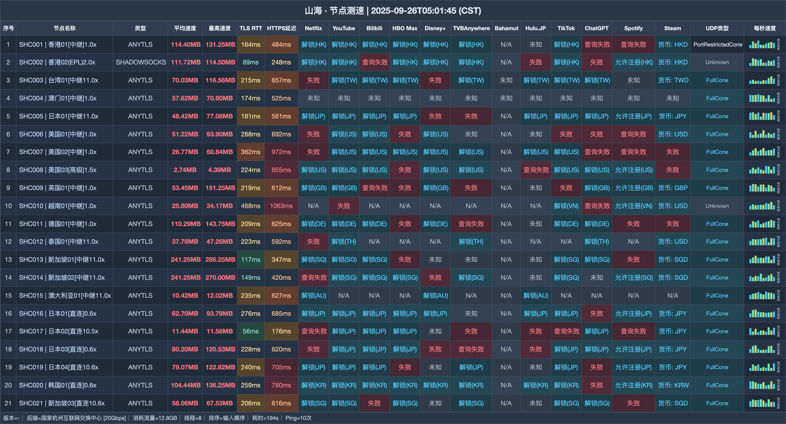

# 山海机场测评｜国内 128G 月档 15 元，海外线路 5 元（2026-10-31 更新）

> **先看结论：国内入口和国际入口分开卖：通用档从 128G 起，海外用户另有 256G 国际小杯。**
>
> 👉 **[进入注册页](https://shanhai.cfd/#/register?code=iyopi9RK)** · 国内连接选 15 元通用迷你；人在海外则比较 5 元国际小杯。

## 哪些人更匹配

- 国内使用且想按 128G—2048G 分档的人
- 设备较多，需要不限设备与不限速的人
- 人在海外，需要单独国际入口的人

## 哪些情况建议跳过

- 身在海外却准备购买通用国内档的人
- 电信晚高峰对国际小杯稳定性要求很高的人

| 快速判断 | 当前信息 |
|---|---|
| 国内首档 | 128G / 15 元月付 |
| 海外首档 | 256G / 5 元月付 |
| 设备数量 | 不限 |
| 速度限制 | 不限 |
| 接入协议 | AnyTLS / Shadowsocks |
| 方案构成 | 5 档通用 + 1 档国际 |

**站点定位**：山海（shanhai）把入口按使用地拆开：国内通用档从 15 元 128G 起，国际小杯为 5 元 256G。

## 全部套餐怎么排

| 套餐 | 价格 | 流量 | 设备 | 限速 | 说明 |
|---|---:|---:|---:|---:|---|
| 通用套餐-迷你 | ¥15/月付 | 128G · 每月 | 不限 | 不限 | 国内入口；海外客户请勿购买 |
| 通用套餐-入门 | ¥25/月付 | 256G · 每月 | 不限 | 不限 | 国内入口；海外客户请勿购买 |
| 通用套餐-基础 | ¥45/月付 | 512G · 每月 | 不限 | 不限 | 国内入口；海外客户请勿购买 |
| 通用套餐-进阶 | ¥85/月付 | 1024G · 每月 | 不限 | 不限 | 国内入口；海外客户请勿购买 |
| 通用套餐-高级 | ¥165/月付 | 2048G · 每月 | 不限 | 不限 | 国内入口；海外客户请勿购买 |
| 国际套餐-小杯 | ¥5/月付 | 256G · 每月 | 不限 | 不限 | Amazon 5Gbps全球骨干网；国际线路晚高峰电信可能不佳 |

**购买前提醒：**通用方案面向国内入口，海外客户不应购买；国际小杯使用 Amazon 5Gbps 全球骨干网，电信晚高峰可能受影响。流量仅在重置日归零，重置包不延长时长，续购只增加时长。

## 节点测速图

测速表有 21 行下载与延迟记录，测试端是 国家杭州互联网交换中心 [20Gbps]，线程数 8。 图中日期为 **2025-09-26**，完整表格如下：

## 选择顺序

1. 国内轻量需求先从 15 元 128G 开始，流量不足再到 25 元 256G。
2. 每月需要 512G 时比较 45 元基础档；不限设备并不等于可公开转售。
3. 海外用户直接看 5 元国际小杯，避免买错国内入口。

## 注册入口

👉 **[打开注册页面](https://shanhai.cfd/#/register?code=iyopi9RK)** · 国内连接选 15 元通用迷你；人在海外则比较 5 元国际小杯。

*本文含推广链接；通过该入口注册或购买，本站可能获得佣金。*

## 本文更新

- **2026-10-31**：重新编排购买建议与全部套餐，共保留 5 个套餐/展示项。
- **2025-09-26**：节点测速图所示日期。

---
*套餐价格、节点与活动可能调整，付款前请以购买页当时显示为准。*

展开相关搜索词

搜索组合：山海、shanhai、山海机场、山海加速、机场测评2026、AnyTLS机场、Shadowsocks机场、代理订阅、山海入口、山海注册、山海测速

